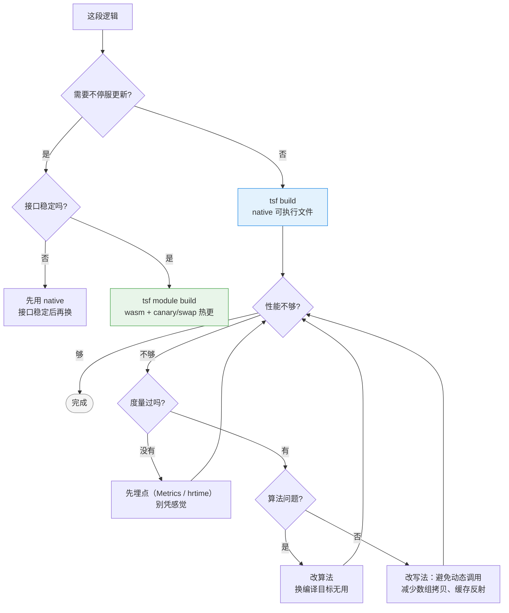

# 使用教程

这套教程分两部分：

1. **第一部分：功能模块逐个讲清楚**——每一层解决什么问题、有哪些类、公开 API 是什么、
   最小用法怎么跑、边界在哪。**先把能力摸清**。
2. **第二部分：一个有深度的示例**——把这些模块串成一个真实玩法，看它们怎么配合。

不建议跳过第一部分直接看示例：那样你会知道"代码长这样"，但不知道"为什么这么拆"，
改需求时只能照抄。

> 想马上看到东西 → [00-quickstart.md](00-quickstart.md)（30 分钟跑通一个服务端）。
> 想看完整的成品 → [07-walkthrough.md](07-walkthrough.md)（能三人真打的斗地主）。
> 写代码时反复报奇怪的运行时错误 → 先看 [08-aot-types.md](08-aot-types.md)。
> 在纠结「这段逻辑该写 PHP 还是上 wasm」→ [09-wasm-or-typephp.md](09-wasm-or-typephp.md)。
> 想了解"为什么这么设计" → `tsf/README.md`（4000 行开发记录）。三者不重复。

## 分层图

```
        ┌────────────────────────────────────────────────┐
   上线 │  06 运维：Metrics · GM · 热更 · 工具链          │
        ├────────────────────────────────────────────────┤
        │  05 分布式：RPC · 发现 · 分片 · 集群 · 熔断     │
        ├────────────────────────────────────────────────┤
        │  04 数据层：DB · 事件日志 · 快照                │
        ├────────────────────────────────────────────────┤
        │  03 玩法层：Room · 帧循环 · AOI · 匹配 · 状态机 │
        ├────────────────────────────────────────────────┤
        │  02 服务层：Service · 定时器 · 配置             │
        ├────────────────────────────────────────────────┤
  客户端│  01 接入层：传输 · 网关 · 协议                  │
        └────────────────────────────────────────────────┘
```

**依赖是单向的**：上层可以调下层，下层不知道上层。所以你可以只用 01+02 写一个小服务，
也可以一路加到 06。

## 一段逻辑该编译成什么



> 两者是**同一个 `tpc` 的两个输出目标**，切换只需改 `project.yml` 一行。
> 判断标准只有一条：**需要不停服更新吗？** 性能不是首要判据——代码同源。
>
> 详见 [09-wasm-or-typephp.md](09-wasm-or-typephp.md)。

## 目录

| # | 篇目 | 覆盖的模块 | 规模 |
|:--|:--|:--|--:|
| 00 | [30 分钟跑起来](00-quickstart.md) | — | ✅ 已验证 |
| 01 | 接入层 | `Transport`(TCP/WS) · `Gateway`(会话/限流/握手) · `Protocol`(帧+消息) · `Proto` | 2400 行 |
| 02 | 服务层 | `Service`(注册/邮箱/调度) · `Timer`(堆/定时/Cron) · `Config`(读取/热更) | 1900 行 |
| 03 | [玩法层](03-gameplay.md) | `pkg/room` · `pkg/frameloop` · `pkg/aoi` · `pkg/match` · `pkg/fsm` · `pkg/entity` | 2700 行 |
| 04 | [数据层](04-data.md) | `pkg/db`(仓储/迁移/分片) · `pkg/eventlog` · `pkg/snapshot` | 2800 行 |
| 05 | [分布式](05-distributed.md) | `Rpc` · `Discovery` · `Shard` · `Cluster` · `Breaker` | 2900 行 |
| 06 | [运维](06-ops.md) | `Metrics` · `Gm` · `pkg/wasm` · `tsf` 工具链 | 1500 行 |
| 07 | [深度示例：一局斗地主](07-walkthrough.md) | 六层拼起来是什么样（1412 行服务端 + 456 行前端） | ✅ 可运行 |
| 08 | [AOT 下的类型契约](08-aot-types.md) | 为什么 PHP 的合法写法在 AOT 下会炸（五类坑 + 排查方法 + 检查清单） | ✅ 全是真实案例 |
| 09 | [编译成 native 还是 wasm](09-wasm-or-typephp.md) | 同一个 tpc 的两种输出目标；什么时候该热更（判断流程 + 真实例子） | ✅ 基于工具链源码 |

## 每篇的固定结构

为了让「讲功能」和「能上手」不脱节，每篇都按同一个顺序：

| 小节 | 回答什么 |
|:--|:--|
| **它解决什么问题** | 没有它会怎样 |
| **核心概念** | 关键类、数据结构、生命周期 |
| **公开 API** | 表格：方法 / 用途 / 注意 |
| **最小用法** | 可运行的代码 + 实际输出（都是跑过的） |
| **边界与坑** | 什么情况会静默出错 |
| **什么时候不该用它** | 避免过度设计 |

## 三条前置认知

不先说清，后面每一步都会困惑：

**1. 这是 AOT，不是解释执行。** 源码在编译期变成机器码，性能接近原生（单 worker
稳态 116 万 msg/s），代价是**运行期改代码必须重编**。开发期 `tsf watch` 把重编压到
**1651 ms**（实测）；线上不停服是另一套机制（wasm 模块热更），见 06 篇。

**2. 类型必须写全。** 局部变量一旦被推断成 `int`，后面不能再赋 `string`。`mixed`
被 lint 禁止，`array<string, mixed>` 也在红线内。这不是风格问题，是能不能编译的问题。

**3. 业务层宽松、热点内部强类型。** 对外接口用 PHP `array` 没问题（灵活），
但每帧都跑的路径要换成具体类型。**不要一上来全局强类型**——先跑通，再按实测优化。
（参考：AOI 换 `std::vector` 经实测只值 2.7% 收益，不值得改。）

## 已知陷阱（都是踩过的，编译期不报）

这几条的共同点是：**代码看着没问题、编译也过，但运行时行为不对或直接崩**。

| # | 现象 | 原因 | 详见 |
|:--|:--|:--|:--|
| 1 | `tsf migrate` 报 `Swoole\Server->__construct()` 异常 | 产物没有 `migrate` 子命令分支，被当成普通启动 | [04](04-data.md) |
| 2 | `onDisconnect` 回调一来就崩 `stdClass->{closure}()` | 回调必须 `(int $fd, int $uid)` 两个参数 | [01](01-ingress.md) |
| 3 | 定时器完全不触发 | 纯服务进程没有传输层驱动 `Scheduler::tick()` | [02](02-service.md) |
| 4 | `Invalid callback` / 闭包变 `stdClass` | 参数写成 `callable` 而不是 `\Closure`（AOT 下联合类型会丢） | [01](01-ingress.md) |
| 5 | 改了 `tsf/src` 但行为没变 | 增量构建不检测框架源码的变更，要清缓存全量重编 | 见下 |
| 6 | `migrate` 成功但表不存在 | MySQL 的服务端预处理不支持 DDL（1295），异常被吞 | [04](04-data.md#mysql-与-sqlite-的差异实测) |
| 7 | 换了 PostgreSQL 报 `could not find driver` | `pdo_pgsql` 不在运行时里，要用 `scripts/build-pdo-pgsql.sh` 单独编 | [04](04-data.md#postgresql反而比-mysql-顺) |

**第 5 条的具体做法**：

```bash
rm -rf ~/typephp-src/build/cache   # 或你的 typephp 构建缓存目录
tsf build .                         # 全量重编，约 25 秒
```

清缓存后第一次编译会慢，但比"改了半天发现没生效"划算。判断是否踩到这一条：
**改动的是 `tsf/src` 或 `tsf/pkg`，而不是自己工程里的文件**。
